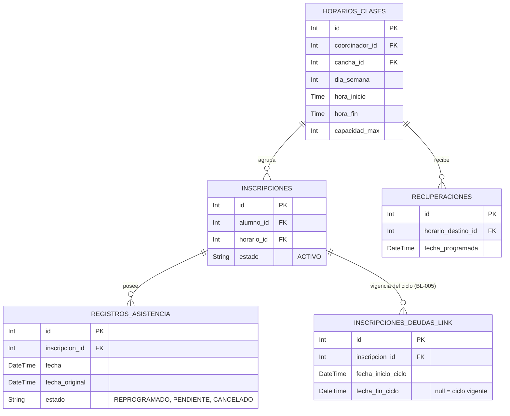

# Clases - Documentación Técnica (Antigravity 🚀)

## 1. Estructura de Archivos
Este feature gestiona el detalle y control de las clases, así como la reprogramación masiva por motivos institucionales.
```text
src/features/clases/
├── clase.routes.js       # Rutas (GET, POST)
├── clase.controller.js   # Interacción HTTP y apiResponse
├── clase.service.js      # Lógica pesada, reprogamaciones y cruce de datos
└── clase.schema.js       # Validaciones Zod (Body para reprogramación, Params para detalle)
```

## 2. Modelo de Datos


## 3. Endpoints

Todas las rutas requieren token (`authenticate`).

| Método | Endpoint | Roles Permitidos | Zod Schema | Descripción |
|---|---|---|---|---|
| POST | `/reprogramar-masivo` | Administrador | `reprogramarMasivoSchema` | Suspende el bloque de una fecha y **repone la clase al final del ciclo de cada alumno** (ver §6). |
| POST | `/revertir-masivo` | Administrador | `revertirMasivoSchema` | Deshace una reprogramación masiva completa por `grupo_uuid`. |
| GET | `/reprogramaciones-masivas-activas` | Administrador | *Ninguno* | Lista las reprogramaciones masivas en estado `ACTIVO`. |
| GET | `/horarios-con-asistencia` | Admin, Coordinador | *Ninguno* | Horarios con al menos una asistencia generada (filtro del selector). |
| GET | `/:horario_id/detalle` | Admin, Coordinador | `horarioIdParamSchema` | Obtiene el detalle general de la clase y los alumnos inscritos activos. |
| GET | `/:horario_id/fechas-disponibles` | Admin, Coordinador | `horarioIdParamSchema` | Fechas futuras (3 meses) que caen en el `dia_semana` del horario. |
| GET | `/:horario_id/fechas-pasadas` | Admin, Coordinador | `horarioIdParamSchema` | Idem hacia atrás (2 meses), con la más reciente primero. |

## 4. Cadena de Middlewares

Ejemplo del flujo de seguridad para `/:horario_id/detalle`:
1. `authenticate`: Verifica que el Token JWT sea válido.
2. `authorize('Administrador', 'Coordinador')`: Verifica permisos del empleado.
3. `validateParams(claseSchema.horarioIdParamSchema)`: Protege el parámetro para garantizar que la DB no colapse con IDs alfanuméricos falsos.
4. `claseController.obtenerDetalle`: Despacha la petición mediante `catchAsync`.

## 5. Schemas Zod

| Schema | Propósito | Se usa en | Uso en Middleware |
|---|---|---|---|
| `reprogramarMasivoSchema` | Valida que ambos IDs de horarios, ambas fechas y un motivo institucional estén presentes y en formato correcto (ISO 8601). | `/reprogramar-masivo` | `validate` |
| `horarioIdParamSchema` | Extrae el parámetro numérico de la URL previniendo errores de casteo en Prisma. | `/:horario_id/detalle` | `validateParams` |

## 6. Lógica Core del Service

El archivo `clase.service.js` delega interacciones delicadas a la BD. Está refactorizado bajo los lineamientos de **Clean Code (Regla §4.3)** de Gema Academy.

* **`reprogramarMasivamente:`** Una sola `$transaction` interactiva con `timeout: 60000`. **No mueve el bloque a otro horario**: suspende la clase de esa fecha y le crea a cada alumno una reposición al FINAL de su propio ciclo, calculada con los días en que ese alumno entrena. Pasos reales:
  1. Carga el horario con sus inscripciones `ACTIVO` (404 / 400 si no hay nadie) y rechaza con 400 si ese bloque ya tiene una reprogramación `ACTIVO` (idempotencia).
  2. Si la fecha es feriado, cancela las asistencias (`CANCELADO`) y retorna temprano con `es_feriado: true`.
  3. 🎯 **BL-005 (pre-pass, antes de tocar nada):** `cargarCiclosVigentes` averigua, para todo el lote y en **dos** consultas, si la clase que se mueve era la **primera del ciclo** de cada alumno. Tiene que correr antes del `updateMany`, porque en cuanto el origen queda en `REPROGRAMADO` deja de contar como clase del ciclo y la pregunta ya no se puede responder.
  4. Crea la cabecera en `reprogramaciones_clases` (con `grupo_uuid`) y marca el origen de todos los alumnos como `REPROGRAMADO`.
  5. Por alumno: calcula su fecha de reposición y crea el registro `PENDIENTE` con el tag `[NO_RECUPERABLE]` (para que marcar FALTA ahí no genere ticket de recuperación).
  6. 🎯 **BL-005:** si esa clase era la primera del ciclo, `aplicarCorrimientoDeCiclo` mueve `inscripciones_deudas_link.fecha_inicio_ciclo` **a la siguiente clase real** y alinea `inscripciones.fecha_inscripcion` los mismos días. `fecha_fin_ciclo` se queda en `NULL` = vigente: el cierre lo deriva `finCicloEfectivo()` y lo aplica el cron VERDUGO contando 30 días desde `fecha_inscripcion` (invariante de BL-006). Esta rama es **excluyente** con la extensión de `fecha_inscripcion` por `id_grupo_transaccion`: si corrieran las dos, el corte se movería dos veces.
  7. Notifica al alumno.

  La aritmética de ciclo vive en `shared/utils/reprogramacion-ciclo.util.js` porque la comparten los **tres** sitios que mueven clases: este service, `revertirReprogramacionMasiva` y `asistencia-cron.service.js -> sincronizarAlumnosNuevosConReprogramaciones` (los inscritos tardíos).

* **`revertirReprogramacionMasiva:`** Simétrica. Devuelve `fecha_inscripcion`, borra las reposiciones, restaura los orígenes a `PENDIENTE` y marca la cabecera como `REVERTIDO`. 🎯 **BL-005:** `resolverReversionDeCiclo` detecta si la ida había corrido el ciclo (el inicio quedó *después* de la fecha movida) y aplica el **mismo delta en negativo**, sin necesidad de persistir nada en una columna nueva.

* **`obtenerDetalleClase:`** Consulta pesada mitigada por Antigravity **Selects**. En vez de incluir todo el objeto `usuarios` y traérselo a memoria para 10-20 alumnos, usa una cascada de sentencias anidadas `select:` limitando el tráfico con la base de datos a `id, nombres, apellidos, email` y algunos campos base de `horarios_clases`, lo cual es estrictamente lo único que requiere el DTO de retorno.
